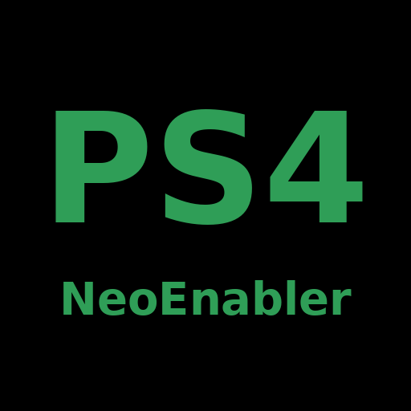

# NeoEnabler

Play PS4 games on your PS5 in **PS4 Pro mode** at higher resolutions, up to native 4K.

The PS5 already runs PS4 games that have PS4 Pro support in Pro mode. Games without it run as on a regular PS4.
NeoEnabler makes those games start as if they were on a PS4 Pro (games with Pro support are left as they are). This
alone does not make any game work: every game tested so far broke in Pro mode without its patch (black or
corrupted image, or the game closing). The patches in `xml/` fix each game for Pro mode and raise its resolution,
so NeoEnabler is only useful for the games listed below.

## What you need

- A jailbroken PS5 on firmware 4.00 to 13.60 (tested on 13.20) with an ELF loader, such as etaHEN or elfldr.
- [ps-patch-system](https://github.com/illusionyy/ps-patch-system), loaded **before** NeoEnabler.

## Install

1. Download `neo-manager.elf` from the [latest release](https://github.com/gasb07/NeoEnabler/releases/latest).
2. After every console boot, load ps-patch-system, then send `neo-manager.elf` with your payload sender
   (port 9021).
3. A notification on the PS5 confirms that NeoEnabler is enabled.

Version **0.2.0** adds an optional **8 GiB PS4 Pro memory budget**, **disabled by default**. It currently
supports **firmware 13.20** (tested) and **13.60** (offsets found, needs hardware test). The hypervisor must
already be unlocked by Byepervisor or another method that allows reading and writing the kernel code page;
NeoEnabler checks that access without relying on exploit-specific markers and does not unlock the hypervisor
itself. Without that access, the normal NEO feature remains available. On other firmwares the 8 GiB
controls are greyed out and the request is refused (since 0.2.1).

**If you are on firmware 13.20 or 13.60, please test the 8 GiB budget and report your results.**

Pro mode stays on until you turn it off or reboot the console. It applies to games you open afterwards.

## Control panel

Open `http://<PS5 IP>:8765` in a browser on your network, or the **NeoEnabler** shortcut in the PS5 Media tab.

- Turn PS4 Pro mode on or off.
- Turn 8 GiB on or off independently of NEO.
- **Save Settings**: saves NEO, 8 GiB and GPU clock settings to `/data/neo-settings` on the PS5. Restored on next startup.
- **Save Diagnostic**: writes firmware metadata to `/data/neo-diagnostic.jsonl` for extraction via FTP.
- See the firmware version, running PS4 games and their DMEM budget.

**Close every game before changing the memory budget.** A memory change requested while a game is open is
applied after games close. Disabling 8 GiB stops automatic enabling; enabling it resumes. NEO and 8 GiB are
independent. Quitting the manager keeps both patches but stops automatic checks. Rebooting removes both patches.

The 8 GiB setting changes the budget for new PS4 Pro launches. Existing games keep their launch budget. It does
not change resolution or force memory pools to grow. Restoring the original budget selects the captured 5.25 GiB
NEO configuration. A failed kernel-write recovery requires a console reboot before launching games.

Anyone on your local network can open the panel.

### GPU clock tab (0.3.0)

Panel actions update the document without adding POST entries to browser history; switching tabs also replaces
the current entry. Circle/Back requests closing the console web interface instead of revisiting earlier actions.

Open **GPU clock** in the panel, select a target from **1800 to 2200 MHz** in 50 MHz steps, and use
**Apply boost**. The current clock reported by the SMU updates every two seconds. The target and enable flag
are saved with **Save Settings** and requested again when the manager starts with a PS4 game running or detects
a new PS4 launch. This works independently of NEO and 8 GiB, including PS4 base mode.

GPU boost is **off by default**, with 2200 MHz selected. It currently supports **firmware 13.20 only** and uses
the stock `/dev/mp1` driver without patching the kernel or relying on a hypervisor exploit marker.
The maximum allowed target is 2200 MHz; sustained frequency may be lower.
The current short gameplay validation covers a 2200 MHz request with SMU readings around 2155–2200 MHz.
FPS gains and long-term stability have not been established.

**Disable boost** requests the clock captured before boost for the running game. **Quit** also requests that
restoration; NEO and memory settings are kept. On game exit/transition the manager stops applying that game's
target and lets the system manage clocks. A new PS4 launch captures a new baseline. The manager does not keep
resending a target when the SMU varies the clock, and it does not change CPU clocks, thermal/power controls,
memory bandwidth, or enabled ROPs. If a clock request or restoration fails, the panel shows the error and stops
automatic retries; use Disable to retry restoration before enabling again.

Live JSON status: `GET /gpu/status`. The saved file adds `gpu_clock_enabled=0|1` and `gpu_clock_mhz=<MHz>`;
older settings files default to GPU boost off. Invalid saved GPU values disable boost. On unsupported firmware,
the controls are greyed out, direct enable requests are refused and a saved GPU enable flag is ignored.

## Game patches

Every game needs its patch from `xml/` to work in PS4 Pro mode. Turn PS4 Pro mode off in the panel before playing
a game that is not in the table below.

1. Copy the game's file to `/data/user/patches/xml_orbis/` on the PS5 and rename it to the title ID only, for
   example `Bloodborne_CUSA00900.xml` becomes `CUSA00900.xml`.

   If ps-patch-system already has a file for that game (`/data/user/patches/xml_orbis/<TITLE ID>.xml`, for example
   `/data/user/patches/xml_orbis/CUSA00900.xml`), don't replace it. Open the game's file from `xml/`, copy every
   `<Metadata ...>` block (each one holds its own `<PatchList>`), and paste them into the existing file, before
   the closing `</Patch>` line. Each `<PatchList>` must stay inside its `<Metadata>` block, or the patch system
   won't load it.
2. In the Patch Manager, enable **one** resolution entry for the game, for example "Native 4K (PS4 Pro mode)".
3. For 4K entries, set the PS5 video output to 2160p.

| Game (version) | Resolutions | Notes |
| --- | --- | --- |
| Need for Speed Rivals (01.04) | 1440p, 4K | If your existing patch file for the game has "Resolution Patch", keep it off. |
| Resident Evil 6 (01.01) | 1440p, 4K | Small Capcom logo in 4K. |
| Bloodborne (01.09) | 1440p, 1620p, 1800p, native 4K | Native 4K needs the 8 GiB memory budget. **Tested on firmware 13.20 only.** |
| Just Cause 3 (01.05) | 1440p, 4K | Also enable "Offline mode", or the game keeps trying to log in. |
| Battlefield 4 (01.24) | 1440p, 1620p, 1800p, 4K | 1800p holds 60 fps. 4K runs around 49 fps. |
| Killzone Shadow Fall (01.81) | 1440p, 1620p, 1800p, 4K | Some surfaces are slightly darker from 1440p to 1800p. 4K is clean but below 60 fps. |
| The Order: 1886 (01.02) | 4K, 4K up to 60 fps | Small sparkles may appear on edges while moving. Native 4K 60fps uses triple buffering: no tearing, slight stutter. |
| Driveclub (01.28) | 1440p, 4K (1800p render), native 4K | 4K needs the 8 GiB memory budget. **Tested on firmware 13.20 only.** 4K with 1800p render runs close to 60 fps; native 4K is below 60 fps in races. In both 4K entries, flickering blocks can show in the clouds and snow can show inside the car. |

Patch IDs, how the hook works and how to build from source: [docs/TECHNICAL.md](docs/TECHNICAL.md).

## Helping extend 8 GiB to other firmwares

The 8 GiB budget is tested on firmware **13.20** only. Firmware **13.60** has verified offsets but needs a
hardware test. To port it to other firmwares we need a diagnostic capture and, ideally, a raw kernel TEXT dump.
Use **Save Diagnostic** in the web panel (or `GET /diagnostic`) and see
[diagnostics/README.md](diagnostics/README.md) for what to submit. **If you are on 13.60, please test and
share your results.**

## Credits

### Code and tools

| Project | Author | Used for |
| --- | --- | --- |
| [ps5-payload-sdk](https://github.com/ps5-payload-dev/sdk) | [John Törnblom](https://github.com/john-tornblom) | Toolchain (`prospero-clang`, `ld.lld`), runtime with `kernel_proc_copyin/out` and `kernel_dynlib_*`, `prospero-deploy` |
| [elfldr](https://github.com/ps5-payload-dev/elfldr) | [ps5-payload-dev](https://github.com/ps5-payload-dev) ([John Törnblom](https://github.com/john-tornblom)) | ELF loader on port 9021 |
| [ps-patch-system](https://github.com/illusionyy/ps-patch-system) | [illusion](https://github.com/illusionyy) | Patch server, XML format, the `getAppInfo` hook the shim chains onto, call site patterns and `ATTRIBUTE` offsets. `src/dynlib.h` and `src/proc.h` copied from `shared/` |
| [ps5-app-dumper](https://github.com/EchoStretch/ps5-app-dumper) | [EchoStretch](https://github.com/EchoStretch) | Reference for the `libSceAppInstUtil` load order and the Media tab shortcut (`deeplinkUri`) |
| [etaHEN](https://github.com/etaHEN/etaHEN) | [LightningMods](https://github.com/LightningMods) | Jailbreak, ELF loader, FTP and klog used during development and testing |
| [Pillow](https://github.com/python-pillow/Pillow) | [python-pillow](https://github.com/python-pillow) | Icon generation (`tools/make_icon.py`) |

### Game patches

| Patch | Author | Source |
| --- | --- | --- |
| Bloodborne: Resolution Patch WxH, base of the NEO 1440p/1620p/1800p entries | [Kyo](https://github.com/Kyoskii) | [shadps4-emu/ps4_cheats](https://github.com/shadps4-emu/ps4_cheats/blob/main/PATCHES/Bloodborne.xml) |
| The Order: 1886: 60 FPS Unlock, used by the Native 4K 60fps entry | [illusion](https://github.com/illusionyy) | PS-Game-Patch, `patches/xml/TheOrder1886-Orbis.xml` |

Entries with author "Local experiment" (Pro mode, resolutions, JC3 offline mode) and the NEO fixes inside the
Bloodborne resolution entries were made in this project.

## License

GPL-3.0 (`LICENSE`). The payload includes the ps5-payload-sdk runtime (GPL-3.0-or-later), so
the binary must be distributed under GPL-3.0.

Third-party files keep their own licenses:

- `src/dynlib.h`, `src/proc.h`: Apache-2.0 (ps-patch-system), compatible with GPL-3.0.
- The Bloodborne resolution code from shadps4-emu/ps4_cheats: the repository declares no license. It is included
  with attribution to its author.
